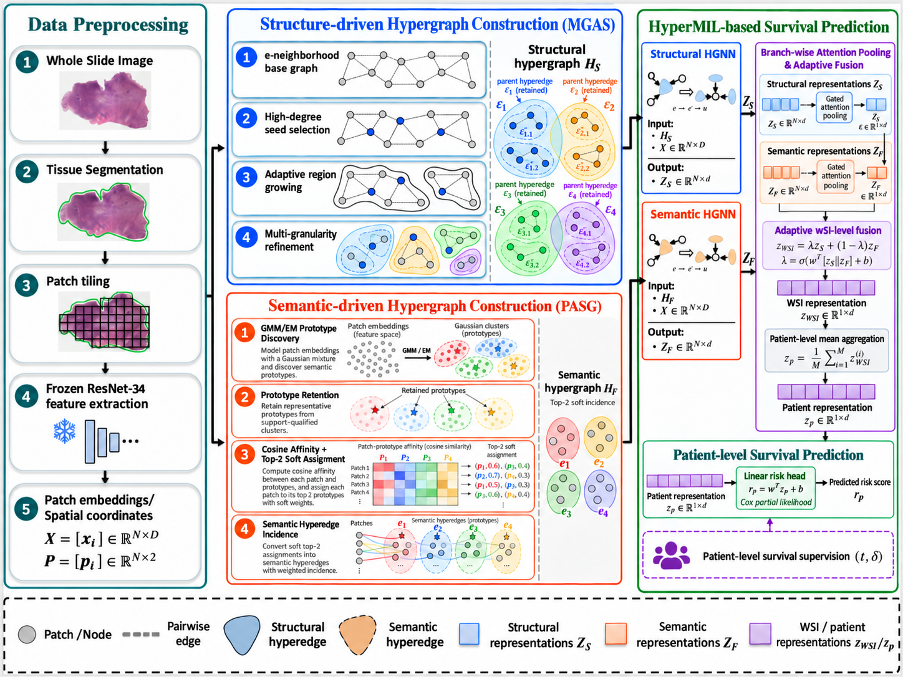

# HyperMIL: Adaptive Spatial–Semantic Hypergraph MIL for Survival Prediction from Whole-Slide Histopathology



**Shenrong Chen, Xiangmin Han, Chenggang Yan, Yuhan Gao, and Zongpeng Li**

[Pretrained models](https://github.com/shannonchen37/HyperMIL/releases/tag/v1.1.0) · [Data (Hugging Face)](https://huggingface.co/datasets/shannonhill/HyperMIL-data) · [Data (Zenodo)](https://doi.org/10.5281/zenodo.23567176) · [Main results](results/table_iii.md) · [Ablation results](results/table_iv.md)

## Overview

Prognostic information in whole-slide histopathology can depend on both spatial tissue organization and similar morphological patterns in distant regions. **HyperMIL** represents these complementary relationships through structural and semantic hypergraphs, allowing a patch to participate in multiple tissue contexts.

The framework has three main components:

- **[Multi-Granularity Adaptive Segmentation (MGAS)](hypermil/preprocessing/mgas.py):** recursively partitions a spatial–feature graph and retains both parent and child regions as overlapping structural hyperedges, preserving coarse and fine tissue contexts.
- **[Posterior-Guided Semantic Grouping (PASG)](hypermil/preprocessing/pasg.py):** discovers slide-specific Gaussian-mixture prototypes and connects each patch to its two most similar prototypes through temperature-scaled cosine affinities, forming sparse, soft semantic incidence across spatially separated regions.
- **Dual-branch learning and adaptive fusion:** independent HGNNs and gated-attention pooling encode the two views. A learned scalar gate fuses the WSI representations, which are averaged within each patient before linear risk prediction with a Cox–Efron objective.

The pipeline starts from frozen **512-dimensional ResNet-34 patch features** and patch coordinates. Hypergraph construction is slide-local and label-independent.

## Experiments and results

The study includes **1,291 patients and 1,344 diagnostic WSIs** from four TCGA cohorts, with overall survival as the endpoint. All slides belonging to a patient remain in the same fold.

| Cohort | Patients | WSIs | Observed events |
| --- | --- | --- | --- |
| TCGA-STAD | 387 | 413 | 163 |
| TCGA-THCA | 505 | 518 | 16 |
| TCGA-CHOL | 39 | 39 | 19 |
| TCGA-LIHC | 360 | 374 | 128 |

### Main comparison

Patient-level Harrell C-index is reported as **mean ± sample standard deviation** over five folds. Macro is the mean of the four unrounded cohort means. Bold denotes the highest mean in each column.

| Method | STAD | THCA | CHOL | LIHC | Macro |
|---|---|---|---|---|---|
| MeanPool | 0.5630 ± 0.0349 | 0.8726 ± 0.0263 | 0.6597 ± 0.1806 | 0.7164 ± 0.0591 | 0.7029 |
| ABMIL | 0.5759 ± 0.0632 | 0.8563 ± 0.0565 | 0.6555 ± 0.2126 | 0.7146 ± 0.0762 | 0.7006 |
| DSMIL | 0.4965 ± 0.0605 | 0.8296 ± 0.0559 | 0.6557 ± 0.2393 | 0.6932 ± 0.0833 | 0.6688 |
| ACMIL | 0.5703 ± 0.0621 | 0.8341 ± 0.0657 | 0.7087 ± 0.1855 | 0.7024 ± 0.0702 | 0.7039 |
| DTFD-MIL | 0.5639 ± 0.0581 | 0.8522 ± 0.0719 | 0.7275 ± 0.1376 | 0.7028 ± 0.0833 | 0.7116 |
| TransMIL | 0.6086 ± 0.0300 | 0.8848 ± 0.0512 | 0.6667 ± 0.1687 | 0.7131 ± 0.0774 | 0.7183 |
| AttriMIL | 0.5413 ± 0.0377 | 0.8101 ± 0.0639 | 0.6983 ± 0.2791 | 0.7004 ± 0.0701 | 0.6875 |
| DualGCN-MIL | 0.5693 ± 0.0595 | 0.8844 ± 0.0432 | 0.6212 ± 0.1611 | 0.7217 ± 0.0638 | 0.6991 |
| PatchGCN | 0.5867 ± 0.0565 | 0.8974 ± 0.0196 | 0.6992 ± 0.2091 | 0.7216 ± 0.0694 | 0.7262 |
| Spatial-KMeans-GroupPool | 0.5558 ± 0.0366 | 0.8698 ± 0.0278 | 0.6597 ± 0.1806 | 0.7166 ± 0.0612 | 0.7005 |
| Semantic-KMeans-GroupPool | 0.5589 ± 0.0246 | 0.8628 ± 0.0239 | 0.6735 ± 0.2030 | 0.7152 ± 0.0594 | 0.7026 |
| IIHGC | 0.5624 ± 0.0364 | 0.8404 ± 0.0467 | **0.7471 ± 0.0738** | 0.7120 ± 0.0841 | 0.7154 |
| Hyper-AdaC | 0.5663 ± 0.0304 | 0.7946 ± 0.1256 | 0.7315 ± 0.1101 | 0.6214 ± 0.0899 | 0.6784 |
| **HyperMIL (Ours)** | **0.6187 ± 0.0472** | **0.9303 ± 0.0349** | 0.7371 ± 0.1202 | **0.7415 ± 0.0671** | **0.7569** |

HyperMIL obtains the highest observed Macro of **0.7569**, with the highest mean on STAD, THCA, and LIHC and the second-highest mean on CHOL. These are point-estimate rankings; the paper reports paired bootstrap uncertainty and discusses checkpoint-selection and external-validation limitations.

### Ablation study

The six variants test the structural branch, semantic branch, structural hierarchy, semantic assignments, adaptive fusion, and hypergraph propagation. The full pipeline has higher observed means than every variant on all four cohorts.

| Method | STAD | THCA | CHOL | LIHC | Macro |
|---|---|---|---|---|---|
| A1: Structure-only | 0.5738 ± 0.0526 | 0.8594 ± 0.0425 | 0.6899 ± 0.1835 | 0.7043 ± 0.0832 | 0.7068 |
| A2: Semantic-only | 0.5716 ± 0.0365 | 0.8596 ± 0.0554 | 0.6926 ± 0.2143 | 0.6953 ± 0.0602 | 0.7048 |
| A3: Leaf-only | 0.5751 ± 0.0568 | 0.8694 ± 0.0311 | 0.7056 ± 0.1666 | 0.7055 ± 0.0496 | 0.7139 |
| A4: Hard semantic | 0.5809 ± 0.0532 | 0.8760 ± 0.0314 | 0.6544 ± 0.1236 | 0.7214 ± 0.0572 | 0.7082 |
| A5: Fixed fusion | 0.5806 ± 0.0437 | 0.8711 ± 0.0290 | 0.6910 ± 0.1436 | 0.7138 ± 0.0200 | 0.7141 |
| A6: Incidence-based GroupPool | 0.5912 ± 0.0582 | 0.8778 ± 0.0307 | 0.6872 ± 0.1628 | 0.7303 ± 0.0703 | 0.7216 |
| **A0: Full pipeline** | 0.6187 ± 0.0472 | 0.9303 ± 0.0349 | 0.7371 ± 0.1202 | 0.7415 ± 0.0671 | 0.7569 |

## Code and pretrained models

This repository provides HyperMIL, **13 baselines**, and **six ablation variants** through a shared YAML-configured framework. Pretrained models cover all four cohorts and all five patient-level cross-validation folds (`0–4`).

## Quick start

### 1. Install

Use Python 3.10 and a CUDA-compatible PyTorch environment.

```bash
git clone https://github.com/shannonchen37/HyperMIL.git
cd HyperMIL
python -m pip install -r requirements.txt
```

The evaluated environment used PyTorch 2.6.0 with CUDA 11.8. Exact tested versions are listed in [requirements-tested.txt](requirements-tested.txt); install the PyTorch build appropriate for your CUDA environment.

### 2. Download pretrained models

```bash
python scripts/download_models.py
# Download only one cohort:
python scripts/download_models.py --cohort STAD
```

The [v1.1.0 release](https://github.com/shannonchen37/HyperMIL/releases/tag/v1.1.0) provides four cohort archives, totaling approximately **0.85 GiB**. The script installs weights into `checkpoints/`. Available cohort options are `STAD`, `THCA`, `CHOL`, and `LIHC` (lowercase input is also accepted).

Each method/cohort/fold has one self-contained `.pt` file, such as `hypermil_stad_fold0.pt` or `ablation_a1_stad_fold0.pt`. File hashes and fold metrics are recorded in [checkpoints/manifest.csv](checkpoints/manifest.csv).

### 3. Download data

The prepared **512-D patch features**, aligned coordinates, and graph/group files are available from [Hugging Face Datasets](https://huggingface.co/datasets/shannonhill/HyperMIL-data) and [Zenodo](https://doi.org/10.5281/zenodo.23567176). The following command downloads the files from Hugging Face directly into the repository layout:

```bash
python scripts/download_data.py
# Download only one cohort:
python scripts/download_data.py --cohort STAD
```

The dataset contains **12,096 files**, totaling **142.87 GB**. Downloads can be resumed by rerunning the same command. Downloading one cohort provides the inputs for all methods on that cohort.

The script saves the data under `data/`, matching the relative paths in [configs/paths.yaml](configs/paths.yaml). No manual path changes or Hugging Face login are required.

**Zenodo alternative:** download every `.tar` archive for the selected cohort from the [Zenodo record](https://zenodo.org/records/23567176) and extract them from the code repository root. STAD has 4 archives, THCA 6, CHOL 1, and LIHC 5. Each archive contains relative `data/` paths, so the extracted inputs work with the same evaluation commands. For example, save all four STAD archives under `downloads/`, then run:

```bash
for archive in downloads/hypermil_data_stad_*.tar; do
    tar -xf "$archive"
done
```

The Zenodo archives contain the same data files as the Hugging Face release; choose either source. Allow disk space for both the downloaded archives and extracted data when using Zenodo.

```text
HyperMIL/
  configs/paths.yaml
  data/
    WSI_data/
      TCGA-STAD/        # also TCGA-THCA, TCGA-CHOL, TCGA-LIHC
        patch_ft/       # patch feature files
        patch_coor/     # patch coordinate files
    hypergraphs/        # HyperMIL graph files
    patchgcn_graphs/     # PatchGCN graph files
    KNN/                # DualGCN-MIL graph files
    kmeans_groups/      # GroupPool group files
```

### 4. Evaluate

Run HyperMIL on one fold:

```bash
python scripts/evaluate.py --config configs/hypermil.yaml --cohort STAD --fold 0
```

Omit `--fold` to evaluate all five folds of that cohort. Available cohorts are `STAD`, `THCA`, `CHOL`, and `LIHC`; the default device is `cuda:0`.

To reproduce both paper tables across all methods and cohorts:

```bash
python scripts/reproduce.py
# Optionally select GPUs:
python scripts/reproduce.py --gpus 0,1
```

The script runs checkpoint inference and resumes completed runs when their recorded code/configuration hashes match. Patient risks and fold reports are written to `results/eval/`. Computed fold C-indices are saved in `results/fold_metrics.csv`; cohort means, sample standard deviations, and four-cohort macro averages are saved in `results/summary_metrics.csv`. Each cohort summary records the available folds, and macro averages are reported when all four cohorts have complete five-fold results. The script prints the computed metrics directly.

## Methods and configuration

**All methods share the data loader, patient splits, evaluation engine, and metric implementation.** YAML files select the model interface, input settings, and method-specific parameters.

The public [patient split file](splits/patient_folds.csv) is shared by every method. The [patch index file](splits/patch_indices.csv) fixes the patch subset identities. Evaluation never generates replacement patient splits.

Switch methods by changing the configuration:

```bash
python scripts/evaluate.py --config configs/hypermil.yaml --cohort STAD --fold 0
python scripts/evaluate.py --config configs/abmil.yaml --cohort STAD --fold 0
python scripts/evaluate.py --config configs/ablation_a1.yaml --cohort STAD --fold 0
```

HyperMIL configuration in [configs/hypermil.yaml](configs/hypermil.yaml):

```yaml
method: HyperMIL
interface: hypermil.interfaces:HypergraphInterface
paths_file: configs/paths.yaml
data:
  feature_manifest: manifests/feature_manifest.csv
  patient_folds: splits/patient_folds.csv
  max_patches: null
  patch_selection: null
model:
  factory: hypermil.models.hypermil:make_hypermil
```

See [configs/config_index.yaml](configs/config_index.yaml) for all method-to-configuration mappings.

| Ablation | Variant | Configuration |
| --- | --- | --- |
| A0 | Full pipeline | [hypermil.yaml](configs/hypermil.yaml) |
| A1 | Structure-only | [ablation_a1.yaml](configs/ablation_a1.yaml) |
| A2 | Semantic-only | [ablation_a2.yaml](configs/ablation_a2.yaml) |
| A3 | Leaf-only | [ablation_a3.yaml](configs/ablation_a3.yaml) |
| A4 | Hard semantic | [ablation_a4.yaml](configs/ablation_a4.yaml) |
| A5 | Fixed fusion | [ablation_a5.yaml](configs/ablation_a5.yaml) |
| A6 | Incidence-based GroupPool | [ablation_a6.yaml](configs/ablation_a6.yaml) |

## Feature extraction and hypergraph construction

**We provide the pre-extracted 512-D patch features, aligned coordinates, and precomputed graph/group files for all four cohorts. Reproducing the paper results does not require feature extraction or graph construction.** Download the prepared inputs using the commands in [Download data](#3-download-data), then proceed directly to evaluation.

The preprocessing code below is optional and supports preparing new WSIs or rebuilding the inputs. The [shared construction script](scripts/build_hypergraphs.py) builds both [MGAS structural hypergraphs](hypermil/preprocessing/mgas.py) and [PASG semantic hypergraphs](hypermil/preprocessing/pasg.py), with PASG prototype fitting implemented in [gmm.py](hypermil/preprocessing/gmm.py).

```bash
python -m pip install -r requirements-preprocessing.txt
# Place raw slides under data/raw_wsi/TCGA-STAD/.
python scripts/extract_features.py --config configs/preprocessing/features.yaml --cohort STAD
python scripts/build_hypergraphs.py --config configs/preprocessing/hypergraphs.yaml --cohort STAD
```

[features.yaml](configs/preprocessing/features.yaml) controls patch sampling and the frozen ResNet-34 extractor. [hypergraphs.yaml](configs/preprocessing/hypergraphs.yaml) controls MGAS and PASG. Both commands accept `STAD`, `THCA`, `CHOL`, and `LIHC` and use repository-relative paths.

PASG fits its slide-specific GMM with **at most 100 EM iterations**, stopping earlier on convergence. This preprocessing budget is independent of the survival model's training epochs. See [preprocessing details](docs/preprocessing.md) for the construction parameters and output formats.

## Training

```bash
python scripts/train.py --config configs/hypermil.yaml --cohort STAD --fold 0 --output runs/hypermil_stad_fold0
```

New runs use the shared trainer with the complete training-patient risk set, Cox loss with Efron correction, and inner-validation checkpoint selection. Model-specific stages are implemented through interfaces. Full-WSI training can require substantial GPU memory.

The experiments used NVIDIA GeForce RTX 3090 GPUs.

## Repository structure

```text
configs/        Method, data-path, and preprocessing configurations
hypermil/       Shared engines, interfaces, models, and preprocessing
scripts/        Download, preprocessing, training, evaluation, and reproduction
splits/         Public patient folds and fixed patch indices
manifests/      Frozen feature manifest
checkpoints/    Model manifest; downloaded .pt files are installed here
results/        Paper tables, comparison summaries, and evaluation outputs
docs/           Preprocessing, distribution notes, and verification reports
```


## Citation

<!-- Add the published paper link and BibTeX citation after publication. -->

## License

The HyperMIL source code is released under the [MIT License](LICENSE). TCGA-derived clinical tables and split files are provided for research reproducibility and remain subject to TCGA/GDC data-use policies. Upstream model implementations and dependencies retain their respective licenses.
